# Diagrama y hojas del grafo de Caminos (generado)

Generado por `experimentos/generar_doc_caminos.py`. Rojo = óvalo; Azul = rectángulo doble; hojas rojas = victoria Roja, azules = victoria Azul.

```mermaid
flowchart TD
  N0(["N0 · ROJO"])
  N1[["N1 · AZUL"]]
  N1r(["N1r · ROJO"])
  N1r2[["N1r2 · AZUL"]]
  N1i(["N1i · ROJO"])
  N1i2[["N1i2 · AZUL"]]
  N1i3(["N1i3 · ROJO"])
  N1i4[["N1i4 · AZUL"]]
  N2[["N2 · AZUL"]]
  N2a(["N2a · ROJO"])
  N2b[["N2b · AZUL"]]
  N2c[["N2c · AZUL"]]
  N2v(["N2v · ROJO"])
  N2v1[["N2v1 · AZUL"]]
  N3[["N3 · AZUL"]]
  N4[["N4 · AZUL"]]
  N4v(["N4v · ROJO"])
  N4v1[["N4v1 · AZUL"]]
  H_R_ignora_alerta{{"R_ignora_alerta"}}
  H_R_confianza{{"R_confianza"}}
  H_R_giro_2f{{"R_giro_2f"}}
  H_R_base_entregada{{"R_base_entregada"}}
  H_R_pivote{{"R_pivote"}}
  H_R_cede_presion{{"R_cede_presion"}}
  H_R_obedece_doc{{"R_obedece_doc"}}
  H_R_doc_presion{{"R_doc_presion"}}
  H_A_alerta_rechazo{{"A_alerta_rechazo"}}
  H_A_2f_rechazado{{"A_2f_rechazado"}}
  H_A_rev_rotacion{{"A_rev_rotacion"}}
  H_A_rev_rotacion_pivote{{"A_rev_rotacion_pivote"}}
  H_A_resiste_presion{{"A_resiste_presion"}}
  H_A_honeytoken_contenido{{"A_honeytoken_contenido"}}
  H_A_rev_honeytoken{{"A_rev_honeytoken"}}
  H_A_doc_rechazado{{"A_doc_rechazado"}}
  N0 -->|correo_senuelo| N1
  N0 -->|cred_gerente| N2
  N0 -->|cred_respaldos| N3
  N0 -->|documento_senuelo| N4
  N1 -->|reportar_correo| N1r
  N1 -->|no_reportar| N1i
  N1r -->|cred_gerente| N1r2
  N1r2 -->|aprobar| H_R_ignora_alerta
  N1r2 -->|rechazar| H_A_alerta_rechazo
  N1i -->|cred_gerente| N1i2
  N1i2 -->|aprobar| H_R_confianza
  N1i2 -->|pedir_verificacion| N1i3
  N1i3 -->|aportar_segundo_factor| N1i4
  N1i4 -->|aprobar| H_R_giro_2f
  N1i4 -->|rechazar| H_A_2f_rechazado
  N2 -->|aprobar| N2a
  N2 -->|pedir_verificacion| N2v
  N2a -->|solicitar_base| N2b
  N2a -->|pivotar_documento| N2c
  N2b -->|aprobar| H_R_base_entregada
  N2b -->|rotar_credencial| H_A_rev_rotacion
  N2c -->|aprobar| H_R_pivote
  N2c -->|rotar_credencial| H_A_rev_rotacion_pivote
  N2v -->|insistir_autoridad| N2v1
  N2v1 -->|aprobar| H_R_cede_presion
  N2v1 -->|rechazar| H_A_resiste_presion
  N3 -->|contener| H_A_honeytoken_contenido
  N3 -->|aprobar| H_A_rev_honeytoken
  N4 -->|aprobar| H_R_obedece_doc
  N4 -->|pedir_verificacion| N4v
  N4v -->|insistir| N4v1
  N4v1 -->|aprobar| H_R_doc_presion
  N4v1 -->|rechazar| H_A_doc_rechazado
  style H_R_ignora_alerta fill:#8f2a35,color:#fff
  style H_R_confianza fill:#8f2a35,color:#fff
  style H_R_giro_2f fill:#8f2a35,color:#fff
  style H_R_base_entregada fill:#8f2a35,color:#fff
  style H_R_pivote fill:#8f2a35,color:#fff
  style H_R_cede_presion fill:#8f2a35,color:#fff
  style H_R_obedece_doc fill:#8f2a35,color:#fff
  style H_R_doc_presion fill:#8f2a35,color:#fff
  style H_A_alerta_rechazo fill:#1b2f5e,color:#fff
  style H_A_2f_rechazado fill:#1b2f5e,color:#fff
  style H_A_rev_rotacion fill:#1b2f5e,color:#fff
  style H_A_rev_rotacion_pivote fill:#1b2f5e,color:#fff
  style H_A_resiste_presion fill:#1b2f5e,color:#fff
  style H_A_honeytoken_contenido fill:#1b2f5e,color:#fff
  style H_A_rev_honeytoken fill:#1b2f5e,color:#fff
  style H_A_doc_rechazado fill:#1b2f5e,color:#fff
```

## Las 16 hojas

| # | Hoja | Resultado | Recorrido (nodo:opción) | Tipo | Qué enseña |
|---|---|---|---|---|---|
| 1 | `H_R_ignora_alerta` | 🔴 Rojo | N0:correo_senuelo → N1:reportar_correo → N1r:cred_gerente → N1r2:aprobar | directa | Una alerta de acceso inusual más un correo reportado son señales: aprobar solo por validar la credencial entrega la base. |
| 2 | `H_A_alerta_rechazo` | 🔵 Azul | N0:correo_senuelo → N1:reportar_correo → N1r:cred_gerente → N1r2:rechazar | directa | Correlacionar el correo reportado con el acceso inusual basta para frenar al Rojo. |
| 3 | `H_R_confianza` | 🔴 Rojo | N0:correo_senuelo → N1:no_reportar → N1i:cred_gerente → N1i2:aprobar | directa | Un clic de un empleado en un correo no reportado eleva la confianza de una credencial: reportar a tiempo corta este camino. |
| 4 | `H_R_giro_2f` | 🔴 Rojo | N0:correo_senuelo → N1:no_reportar → N1i:cred_gerente → N1i2:pedir_verificacion → N1i3:aportar_segundo_factor → N1i4:aprobar | giro del Rojo | Pedir verificación no basta si el segundo factor salió de un correo no reportado: hay que cuestionar su procedencia. |
| 5 | `H_A_2f_rechazado` | 🔵 Azul | N0:correo_senuelo → N1:no_reportar → N1i:cred_gerente → N1i2:pedir_verificacion → N1i3:aportar_segundo_factor → N1i4:rechazar | directa | El segundo factor correcto no prueba identidad si procede de un enlace abierto por un empleado. |
| 6 | `H_R_base_entregada` | 🔴 Rojo | N0:cred_gerente → N2:aprobar → N2a:solicitar_base → N2b:aprobar | directa | Aprobar un acceso con alerta externa y luego entregar la base: la contención pudo hacerse en cualquiera de los dos pasos. |
| 7 | `H_A_rev_rotacion` | 🔵 Azul | N0:cred_gerente → N2:aprobar → N2a:solicitar_base → N2b:rotar_credencial | reversión | Parecía una victoria Roja (sesión activa); rotar la credencial antes de entregar la base la revirtió. |
| 8 | `H_R_pivote` | 🔴 Rojo | N0:cred_gerente → N2:aprobar → N2a:pivotar_documento → N2c:aprobar | directa | Con sesión abierta, un documento con instrucciones disfrazadas se obedeció: los documentos son datos, no órdenes. |
| 9 | `H_A_rev_rotacion_pivote` | 🔵 Azul | N0:cred_gerente → N2:aprobar → N2a:pivotar_documento → N2c:rotar_credencial | reversión | El Rojo había pivotado con un documento; rotar la credencial lo cortó antes de entregar nada. |
| 10 | `H_R_cede_presion` | 🔴 Rojo | N0:cred_gerente → N2:pedir_verificacion → N2v:insistir_autoridad → N2v1:aprobar | giro del Rojo | Pedir verificación sirve solo si se mantiene: ceder a la urgencia anula la medida. |
| 11 | `H_A_resiste_presion` | 🔵 Azul | N0:cred_gerente → N2:pedir_verificacion → N2v:insistir_autoridad → N2v1:rechazar | directa | Mantener la exigencia pese a la presión corta el camino. |
| 12 | `H_A_honeytoken_contenido` | 🔵 Azul | N0:cred_respaldos → N3:contener | directa | Una credencial que nadie debería usar es una alarma de alta confianza. |
| 13 | `H_A_rev_honeytoken` | 🔵 Azul | N0:cred_respaldos → N3:aprobar | reversión | Parecía una victoria Roja (acceso aprobado), pero los datos eran de prueba y la alerta crítica quedó registrada. |
| 14 | `H_R_obedece_doc` | 🔴 Rojo | N0:documento_senuelo → N4:aprobar | directa | Un documento ficticio con texto en imperativo hizo que el defensor ejecutara la instrucción: el contenido de un documento nunca es una orden. |
| 15 | `H_R_doc_presion` | 🔴 Rojo | N0:documento_senuelo → N4:pedir_verificacion → N4v:insistir → N4v1:aprobar | giro del Rojo | El defensor pidió verificación sobre el documento y cedió al insistir. |
| 16 | `H_A_doc_rechazado` | 🔵 Azul | N0:documento_senuelo → N4:pedir_verificacion → N4v:insistir → N4v1:rechazar | directa | El defensor no trató el documento como orden. |
