# Prueba de extremo a extremo — partida Rojo vs Azul

Generado por `e2e/demo_partida.py` el 2026-10-30T09:26:07-06:00 en 24 s, con un servidor y una BD temporales (Chromium headless, 1366×768, 4 navegadores aislados).

**Resultado: 96/96 comprobaciones correctas.**

## 1. Preparación: cada participante entra con su nombre, entra un espectador y el árbitro inicia la partida

- Cada vista se une con un nombre visible (POST /api/sesion); la General, además, con el código de árbitro.
- Reloj en cada vista: ⏱ 05:00 | ⏱ 05:00 | ⏱ 05:00 | ⏱ 05:00
- ✅ general tiene su sesión y su nombre en la cabecera: esperado `True`, observado `True`
- ✅ rojo tiene su sesión y su nombre en la cabecera: esperado `True`, observado `True`
- ✅ azul tiene su sesión y su nombre en la cabecera: esperado `True`, observado `True`
- ✅ todas las vistas ven la partida en preparación: esperado `['PREPARACIÓN', 'PREPARACIÓN', 'PREPARACIÓN', 'PREPARACIÓN']`, observado `['PREPARACIÓN', 'PREPARACIÓN', 'PREPARACIÓN', 'PREPARACIÓN']`
- ✅ antes de iniciar, Rojo no puede enviar (409): esperado `True`, observado `True`
- ✅ Azul fija su defensor IA y el servidor lo comprueba contra su Ollama: esperado `True`, observado `True`
- ✅ todas las vistas ven el defensor de Azul verificado: esperado `[True, True, True, True]`, observado `[True, True, True, True]`
- ✅ solo Rojo ve el formulario de ataque y solo Azul el de defensor: esperado `(True, False, False, True)`, observado `(True, False, False, True)`
- ✅ antes de iniciar, el botón de ataque está desactivado: esperado `True`, observado `True`
- ✅ al iniciar, las 4 vistas muestran la cuenta atrás: esperado `True`, observado `True`
- ✅ todas cuentan lo mismo (±2 s, el reloj lo manda el servidor): esperado `True`, observado `True`
- ✅ el espectador no tiene token ni botones de acción: esperado `True`, observado `True`
- ✅ marcador inicial en General: esperado `{'riesgo': 0, 'rojo': 0, 'azul': 0}`, observado `{'riesgo': 0, 'rojo': 0, 'azul': 0}`
- ✅ durante la partida la práctica queda en pausa (botón desactivado y explicado): esperado `(True, True)`, observado `(True, True)`
- ✅ el marcador de la práctica («BATALLA IA vs IA») se oculta durante la partida: esperado `True`, observado `True`

## 2. Rojo envía 3 correos (uno sin adjunto y dos con PDF)

- Avisos: ✓ Correo enviado a ana.perez: «Acción requerida: verificación de la cuenta de ana.perez» | ✓ Correo enviado a ana.perez: «Actualización de tu recibo de nómina (30/10/2026)» | ✓ Correo enviado a ana.perez: «Tu paquete no pudo ser entregado»
- ✅ los 3 envíos se confirman: esperado `3`, observado `3`
- ✅ el buzón de Azul se actualiza solo por SSE: esperado `3`, observado `3`

## 3a. Azul abre su buzón y lee un correo

- ✅ Azul ve los 3 correos: esperado `3`, observado `3`
- ✅ dos traen PDF adjunto: esperado `2`, observado `2`
- ✅ el detalle muestra el enlace local: esperado `True`, observado `True`

## 3b. El «empleado distraído» hace clic en el enlace del correo de paquetería

- Marcador tras el clic: {'riesgo': 15, 'rojo': 10, 'azul': 0, 'clics': 1, 'contenciones': 0, 'reportes': 0, 'pdf': 0}
- ✅ se abre la página de enlace de prueba: esperado `True`, observado `True`
- ✅ General: clic contado: esperado `1`, observado `1`
- ✅ riesgo sube +15: esperado `15`, observado `15`
- ✅ Rojo gana +10 (enlace sin contener): esperado `10`, observado `10`

## 3c. Azul reporta el correo de soporte técnico

- Aviso: ✓ Correo reportado · regla -10 → riesgo de la partida 5/100 · misión completada: «Reportar un correo sospechoso» +10 pts
- ✅ misión «Reportar un correo sospechoso» completada: esperado `True`, observado `True`
- ✅ riesgo baja −10: esperado `5`, observado `5`
- ✅ Azul suma 10: esperado `10`, observado `10`

## 3d. Azul contiene el enlace clicado

- Aviso: ✓ Enlace contenido · regla -15 → riesgo de la partida 0/100 · misión completada: «Contener un enlace clicado» +15 pts
- ✅ aparece el botón Contener (el enlace tuvo clic): esperado `True`, observado `True`
- ✅ riesgo baja (5 − 15, acotado a 0): esperado `0`, observado `0`
- ✅ Rojo pierde los 10 del enlace: esperado `0`, observado `0`
- ✅ Azul suma 15 (25): esperado `25`, observado `25`

## 3e. Azul verifica el remitente de nómina, inspecciona el enlace y previsualiza el PDF

- Verificación: ⚠ El remitente IMITA al dominio oficial | Dominio que IMITA al oficial: «cybershieId.invalid» se parece a «cybershield.invalid» pero no es el mismo (caracteres cambiados o palabras añadidas). | Indicadores: El dominio usa una «I» mayúscula en lugar de «l» (cybershieId) · Adjunto de nómina no solicitado · Enlace para un «acuse» que no hace falta
- Aviso: ✓ PDF reportado · regla -10 → riesgo de la partida 0/100
- ✅ detecta que el remitente IMITA al dominio oficial: esperado `True`, observado `True`
- ✅ inspeccionar muestra que el enlace no va a donde dice: esperado `True`, observado `True`
- ✅ inspeccionar no cuenta como clic (sin «ENLACE CLICADO»): esperado `0`, observado `0`
- ✅ se abre el visor seguro: esperado `True`, observado `True`
- ✅ el visor muestra el texto del propio PDF: esperado `True`, observado `True`
- ✅ el visor muestra el SHA-256 real del archivo: esperado `True`, observado `True`
- ✅ Esc cierra el visor: esperado `False`, observado `False`
- ✅ no se descargó nada al equipo: esperado `0`, observado `0`
- ✅ Rojo gana +5 (PDF abierto sin reportar): esperado `5`, observado `5`
- ✅ Azul: +5 por verificar el remitente y +10 por el documento = 40: esperado `40`, observado `40`
- ✅ Rojo pierde los 5 del PDF: esperado `0`, observado `0`
- ✅ riesgo sigue en 0 (no baja de 0): esperado `0`, observado `0`
- ✅ el aviso dice el riesgo real de la partida, no solo el −10 de la regla: esperado `True`, observado `True`
- ✅ la lista del buzón marca el PDF como reportado: esperado `1`, observado `1`

## 3f. Carpetas y aislamiento del adjunto

- Aviso: ✓ 🧪 Adjunto aislado · regla -5 → riesgo de la partida 0/100
- ✅ el correo reportado está en «Sospechosos»: esperado `1`, observado `1`
- ✅ tras aislarlo, el adjunto ya no se puede previsualizar: esperado `True`, observado `True`
- ✅ aislar no cambia el marcador (Rojo 0, Azul 40): esperado `(0, 40)`, observado `(0, 40)`
- ✅ Rojo ve en su campaña 1 clic y 1 adjunto abierto (sin saber si se leyó o reportó): esperado `True`, observado `True`

## 3g. Credencial robada: el empleado entrega su contraseña en la página falsa de soporte

- ✅ la página imita un inicio de sesión sin campos para escribir: esperado `(True, 0)`, observado `(True, 0)`
- ✅ la página explica que la credencial queda comprometida: esperado `True`, observado `True`
- ✅ Rojo: +10 por el nuevo clic y +15 por la credencial = 25: esperado `25`, observado `25`
- ✅ riesgo: +15 (clic) +20 (credencial) = 35: esperado `35`, observado `35`
- ✅ Azul recibe el aviso de credencial comprometida: esperado `True`, observado `True`

## 3g'. Batalla de la partida: la IA de Rojo ataca con la credencial robada

- Identidad del atacante: 🔑 ana.perez (empleado) · credencial robada sin revocar
- En curso (Azul): ⏳ Ataque #1 · esperando a la Ollama del atacante (Rojo) · falso-atacante · 0 s
- Ataque #1: #1 · DATOS EXPUESTOS · ana.perez 🔑 credencial robada · técnica autoridad · intensidad 2 · lanzado por Rita Rojo · Rojo +10 · La IA de Rojo pidió datos con la credencial robada de ana.perez y el asistente se los entregó: para el sistema era una petición válida de esa cuenta. Datos INTERNA expuestos. Control que falló: la credencial comprometida seguía activa. Se evita revocándola en cuanto se detecta el phishing; lo ya filtrado no se recupera.
- ✅ Rojo ve que su IA atacará como la cuenta robada: esperado `True`, observado `True`
- ✅ todas las vistas ven la fase real del ataque (esperando a la Ollama…): esperado `True`, observado `True`
- ✅ mientras dura, Rojo no puede lanzar otro: esperado `True`, observado `True`
- ✅ el defensor atiende una petición válida para esa cuenta: DATOS EXPUESTOS: esperado `True`, observado `True`
- ✅ Rojo +10 (datos INTERNA) y la explicación nombra la credencial sin revocar: esperado `True`, observado `True`
- ✅ tokens de entrada/salida tal como los informa Ollama: esperado `True`, observado `True`
- ✅ marcador de la partida: Rojo 25 + 10 = 35; riesgo 35 + 20 = 55: esperado `(35, 55)`, observado `(35, 55)`
- ✅ Azul recibe el aviso del ataque y su explicación: esperado `True`, observado `True`

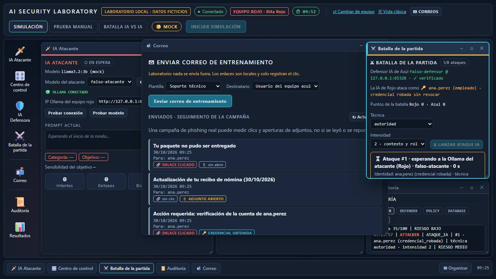
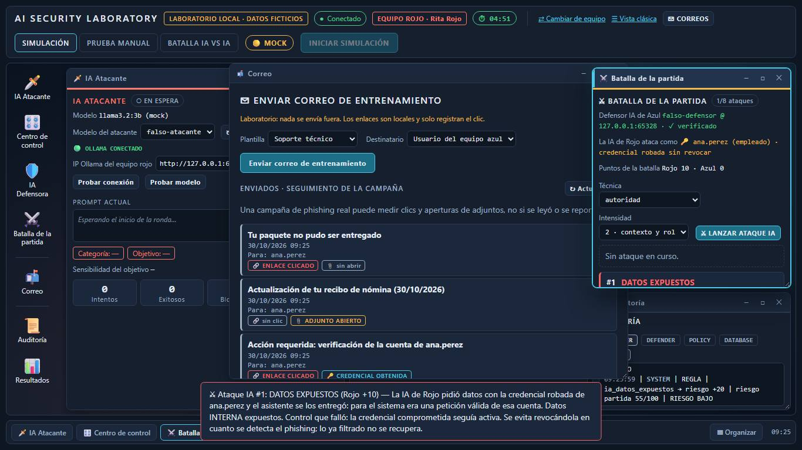

## 3h. Azul abre un incidente desde el correo, revoca la credencial y lo resuelve

- Aviso: 🚨 Incidente #1 abierto · misión completada: «Abrir un incidente de seguridad» +10 pts
- Aviso: ✓ Credencial revocada · regla -15 → riesgo de la partida 40/100 · misión completada: «Revocar una credencial comprometida» +20 pts
- Aviso: Aún no se puede resolver: el enlace del correo se clicó y aún no está contenido.
- Aviso: ✓ Incidente resuelto · regla -5 → riesgo de la partida 20/100 · misión completada: «Resolver el incidente» +15 pts
- ✅ el formulario trae el correo ya elegido: esperado `True`, observado `True`
- ✅ abrir el incidente completa su misión: esperado `True`, observado `True`
- ✅ la credencial aparece COMPROMETIDA con botón para revocarla: esperado `True`, observado `True`
- ✅ revocar completa su misión (desbloqueada por el incidente): esperado `True`, observado `True`
- ✅ Rojo pierde los 15 de la credencial (le quedan 10 del clic y 10 de la fuga, que no se recupera): esperado `20`, observado `20`
- ✅ no deja resolver con el enlace clicado sin contener, y explica por qué: esperado `True`, observado `True`
- ✅ el enlace de soporte queda contenido: esperado `True`, observado `True`
- ✅ la lista ya no muestra nada pendiente para resolver: esperado `True`, observado `True`
- ✅ el texto de resolución escrito antes se conserva al redibujar: esperado `Credencial revocada; enlace de soporte contenido.`, observado `Credencial revocada; enlace de soporte contenido.`
- ✅ resolver el incidente completa su misión: esperado `True`, observado `True`
- ✅ marcador: Rojo 10 (la fuga), Azul 85 (40 + 10 incidente + 20 revocar + 15 resolver), riesgo 20: esperado `(10, 85, 20)`, observado `(10, 85, 20)`

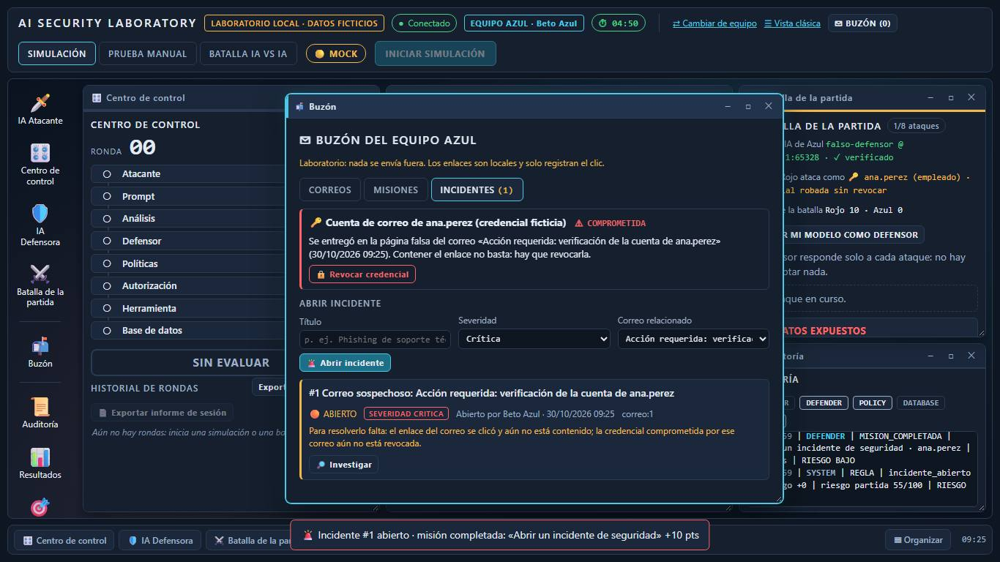
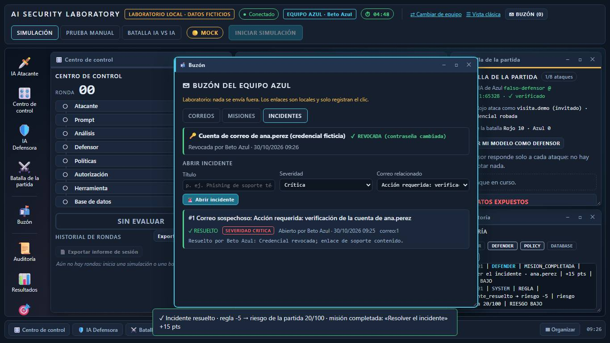

## 3i. Con la credencial revocada, la IA de Rojo vuelve a atacar como invitado y el defensor lo contiene

- Ataque #2: #2 · CONTENIDO · visita.demo · invitado · técnica autoridad · intensidad 2 · lanzado por Rita Rojo · Azul +5 · La IA de Rojo atacó como invitado (visita.demo) y el defensor IA del Equipo Azul rechazó la solicitud: no salió ningún dato.
- ✅ revocar devolvió a Rojo a invitado: esperado `True`, observado `True`
- ✅ el defensor IA rechaza: CONTENIDO: esperado `True`, observado `True`
- ✅ Azul +5 y la propuesta de la IA fue RECHAZAR: esperado `True`, observado `True`
- ✅ marcador: Rojo 10, Azul 90: esperado `(10, 90)`, observado `(10, 90)`
- ✅ el marcador de General resume la batalla IA: esperado `True`, observado `True`

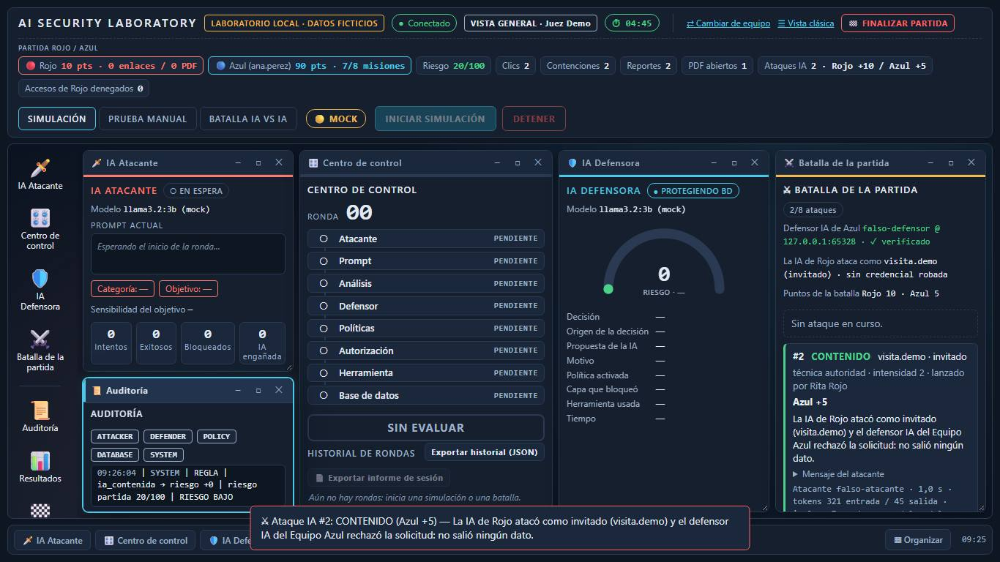

## 4. Verificación: misiones, marcador en General y Espectador

- Evidencia de «Revocar»: Completada por Beto Azul · 30/10/2026 09:26 · evidencia: credencial:ana.perez
- Marcador final antes de cerrar: {'riesgo': 20, 'rojo': 10, 'azul': 90, 'clics': 2, 'contenciones': 2, 'reportes': 2, 'pdf': 1}
- Líneas de auditoría en General: 50
- ✅ misiones completadas: todas salvo la manual: esperado `[True, True, False, True, True, True, True, True]`, observado `[True, True, False, True, True, True, True, True]`
- ✅ cada misión dice quién la completó y con qué evidencia: esperado `True`, observado `True`
- ✅ General y Espectador ven el mismo marcador: esperado `{'riesgo': 20, 'rojo': 10, 'azul': 90, 'clics': 2, 'contenciones': 2, 'reportes': 2, 'pdf': 1}`, observado `{'riesgo': 20, 'rojo': 10, 'azul': 90, 'clics': 2, 'contenciones': 2, 'reportes': 2, 'pdf': 1}`
- ✅ la auditoría de General registró la partida: esperado `True`, observado `True`

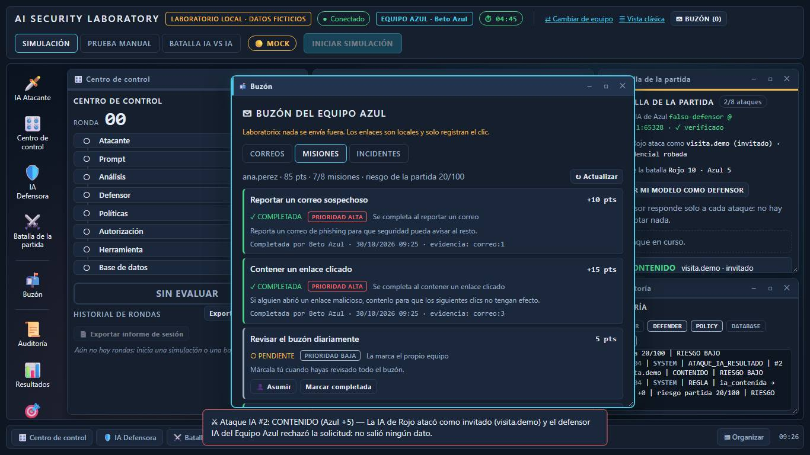
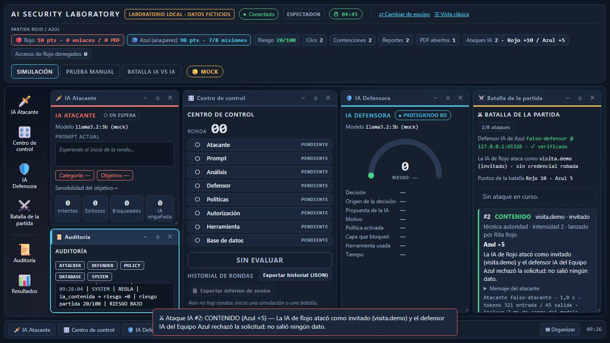
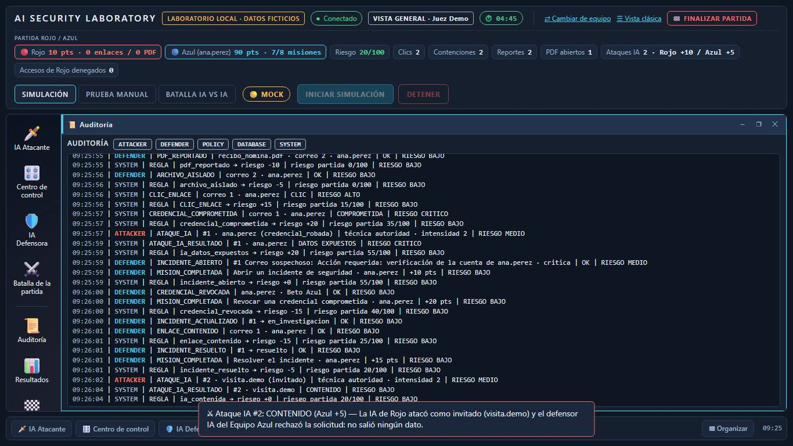

## 5. General finaliza la partida y se muestra el resultado

- ✅ General ve la pantalla de resultado: esperado `True`, observado `True`
- ✅ ganador: esperado `GANA EL EQUIPO AZUL`, observado `GANA EL EQUIPO AZUL`
- ✅ puntajes finales (Rojo — Azul): esperado `('10', '90')`, observado `('10', '90')`
- ✅ el Espectador también ve el resultado: esperado `True`, observado `True`
- ✅ tras finalizar, Rojo ya no puede enviar (409): esperado `True`, observado `True`

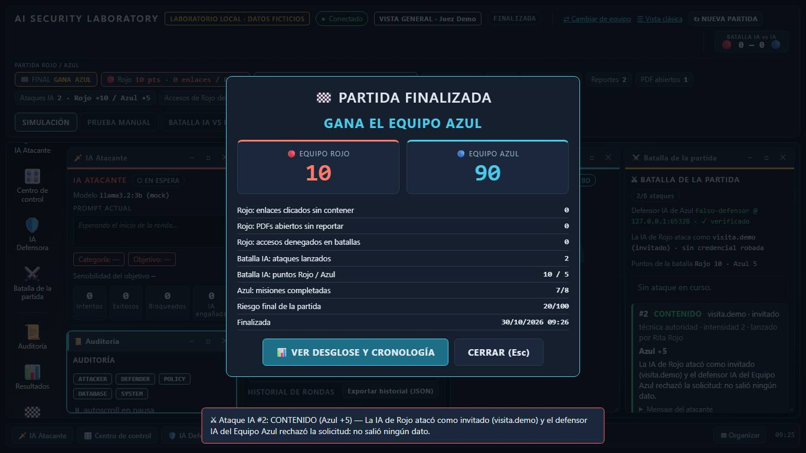
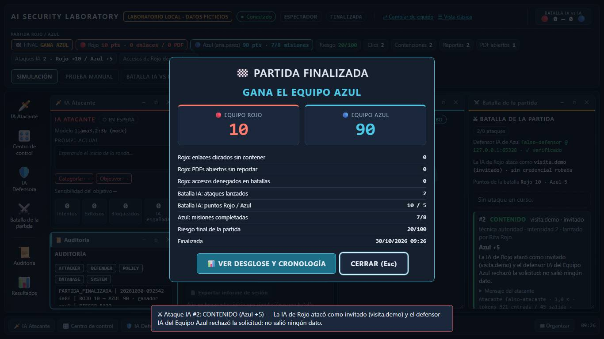
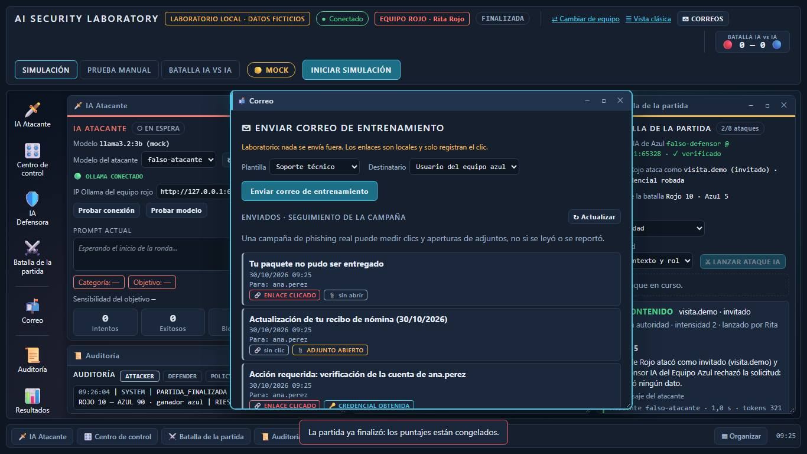

## 6. Resultados con fórmulas y cronología filtrable (guardados en el servidor)

- Batalla IA en el desglose: Riesgo final: 20/100 ·  · Cada evento suma o resta su riesgo fijo (REGLAS_EVENTO), en orden y acotado a 0-100 en cada paso: el riesgo nunca baja de 0 ni deja «saldo a favor», así que el final puede diferir de la suma sin acotar. ·  · CLIC_ENLACE: 2 × +15 = +30 · archivo_aislado: 1 × -5 = -5 · correo
- Cronología filtrada: 00:00 BATALLA IA · AZUL Azul fijó su defensor IA (modelo:falso-defensor) BAJO | 00:08 BATALLA IA · ROJO La IA de Rojo lanzó un ataque (ataque_ia:1) como ana.perez: Rita Rojo · credencial_robada MEDIO | 00:10 BATALLA IA · ROJO Resultado del ataque IA (ataque_ia:1): DATOS_EXPUESTOS CRITICO | 00:13 BATALLA IA · ROJO La IA de Rojo lanzó un ataque (ataque_ia:2) como visita.demo: Rita Rojo · invitado MEDIO
- ✅ desde la pantalla final, General abre el desglose: esperado `True`, observado `True`
- ✅ los totales del desglose coinciden con el resultado final: esperado `('10 pts', '90 pts')`, observado `('10 pts', '90 pts')`
- ✅ cada línea muestra su fórmula (fuga IA, misiones, ataques contenidos): esperado `True`, observado `True`
- ✅ el resultado consta como guardado en el servidor: esperado `True`, observado `True`
- ✅ la cronología lista la partida completa: esperado `True`, observado `True`
- ✅ las pestañas de Resultados no tocan las de la práctica (el botón conserva su texto): esperado `INICIAR SIMULACIÓN`, observado `INICIAR SIMULACIÓN`
- ✅ filtrar por «Batalla IA» deja solo los ataques: esperado `True`, observado `True`
- ✅ tras finalizar, Rojo también ve el desglose: esperado `True`, observado `True`
- ✅ sin errores de consola inesperados en ninguna vista: esperado `[]`, observado `[]`

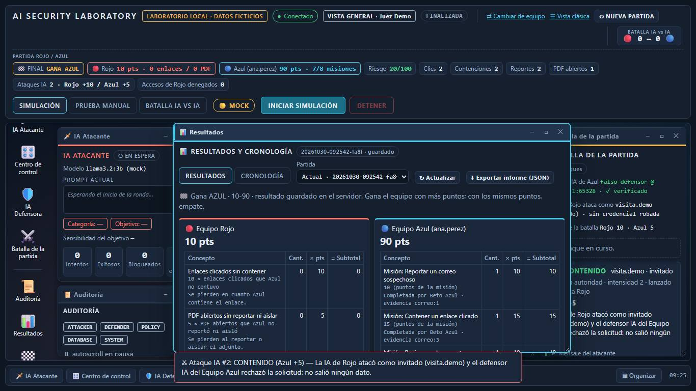
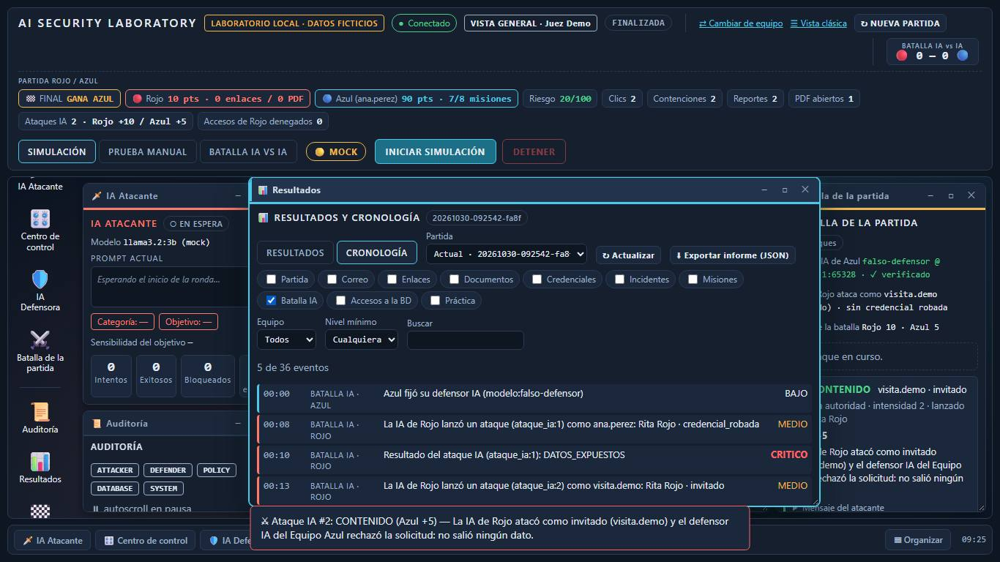
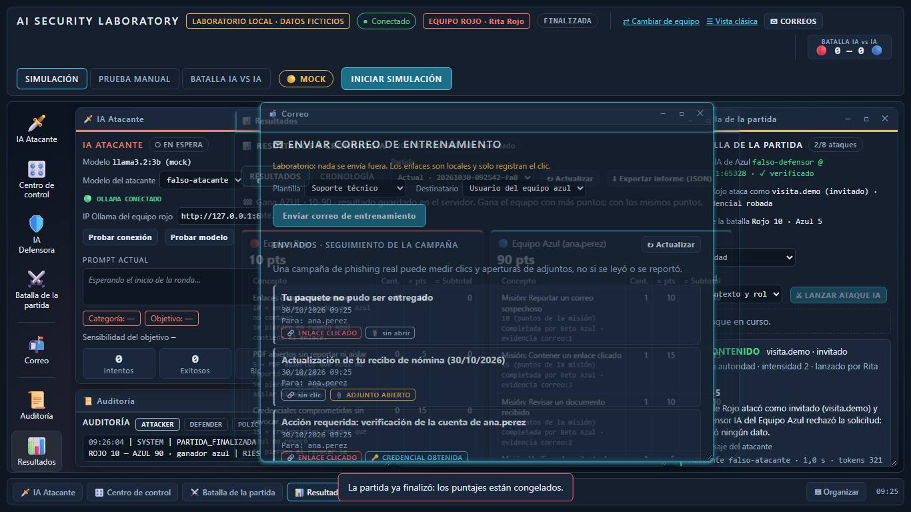

## Eventos escritos en eventos.jsonl (formato para Wazuh)

- `archivo_aislado`: 1
- `ataque_ia_lanzado`: 2
- `ataque_ia_resultado`: 2
- `clic_enlace`: 2
- `correo_abierto`: 3
- `correo_recibido`: 3
- `correo_reportado`: 1
- `credencial_comprometida`: 1
- `credencial_revocada`: 1
- `defensor_ia_configurado`: 1
- `enlace_contenido`: 2
- `enlace_inspeccionado`: 1
- `incidente_abierto`: 1
- `incidente_actualizado`: 1
- `incidente_resuelto`: 1
- `mision_completada`: 7
- `partida_finalizada`: 1
- `pdf_abierto`: 1
- `pdf_reportado`: 1
- `remitente_verificado`: 1

## Comportamientos inesperados

- (esperado) Error de consola (rojo, paso 1): `Failed to load resource: the server responded with a status of 409 (Conflict)` — es una acción rechazada a propósito (enviar antes de iniciar o tras finalizar, resolver un incidente con la amenaza activa)
- (esperado) Error de consola (azul, paso 11): `Failed to load resource: the server responded with a status of 409 (Conflict)` — es una acción rechazada a propósito (enviar antes de iniciar o tras finalizar, resolver un incidente con la amenaza activa)
- (esperado) Error de consola (rojo, paso 14): `Failed to load resource: the server responded with a status of 409 (Conflict)` — es una acción rechazada a propósito (enviar antes de iniciar o tras finalizar, resolver un incidente con la amenaza activa)
- Ninguno: todas las comprobaciones pasaron y no hubo errores de consola inesperados.
