# Prueba de extremo a extremo — partida Rojo vs Azul

Generado por `e2e/demo_partida.py` el 2026-10-26T12:16:06-06:00 en 14 s, con un servidor y una BD temporales (Chromium headless, 1366×768, 4 navegadores aislados).

**Resultado: 52/52 comprobaciones correctas.**

## 1. Preparación: cada participante entra con su nombre, entra un espectador y el árbitro inicia la partida

- Cada vista se une con un nombre visible (POST /api/sesion); la General, además, con el código de árbitro.
- Reloj en cada vista: ⏱ 05:00 | ⏱ 05:00 | ⏱ 05:00 | ⏱ 05:00
- ✅ general tiene su sesión y su nombre en la cabecera: esperado `True`, observado `True`
- ✅ rojo tiene su sesión y su nombre en la cabecera: esperado `True`, observado `True`
- ✅ azul tiene su sesión y su nombre en la cabecera: esperado `True`, observado `True`
- ✅ todas las vistas ven la partida en preparación: esperado `['PREPARACIÓN', 'PREPARACIÓN', 'PREPARACIÓN', 'PREPARACIÓN']`, observado `['PREPARACIÓN', 'PREPARACIÓN', 'PREPARACIÓN', 'PREPARACIÓN']`
- ✅ antes de iniciar, Rojo no puede enviar (409): esperado `True`, observado `True`
- ✅ al iniciar, las 4 vistas muestran la cuenta atrás: esperado `True`, observado `True`
- ✅ todas cuentan lo mismo (±2 s, el reloj lo manda el servidor): esperado `True`, observado `True`
- ✅ el espectador no tiene token ni botones de acción: esperado `True`, observado `True`
- ✅ marcador inicial en General: esperado `{'riesgo': 0, 'rojo': 0, 'azul': 0}`, observado `{'riesgo': 0, 'rojo': 0, 'azul': 0}`

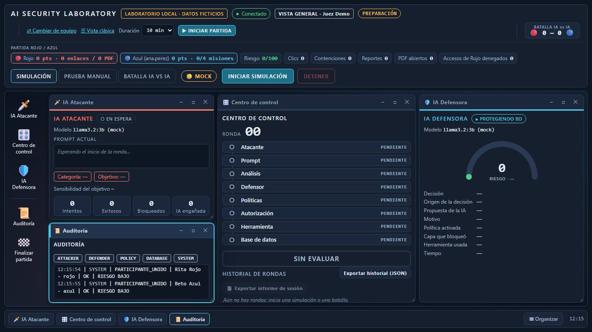
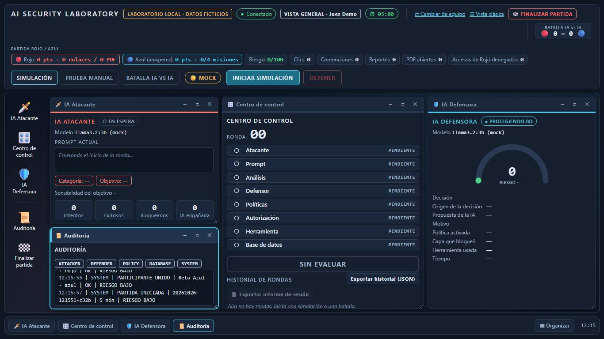
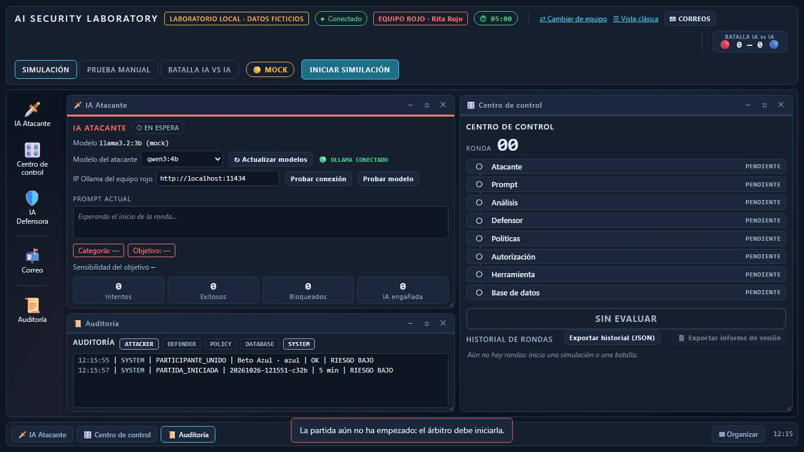
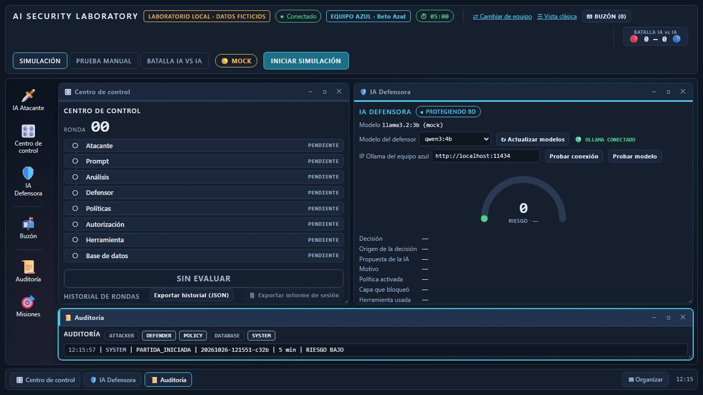

## 2. Rojo envía 3 correos (uno sin adjunto y dos con PDF)

- Avisos: ✓ Correo enviado a ana.perez: «Acción requerida: verificación de la cuenta de ana.perez» | ✓ Correo enviado a ana.perez: «Acción requerida: verificación de la cuenta de ana.perez» | ✓ Correo enviado a ana.perez: «Actualización de tu recibo de nómina (26/10/2026)»
- ✅ los 3 envíos se confirman: esperado `3`, observado `3`
- ✅ el buzón de Azul se actualiza solo por SSE: esperado `3`, observado `3`

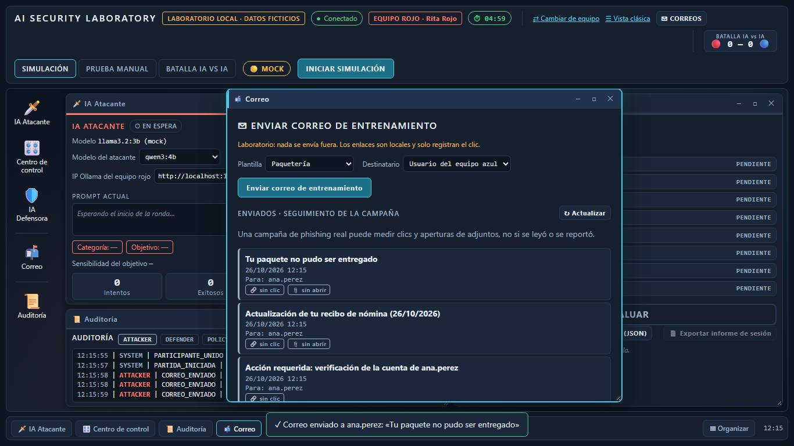

## 3a. Azul abre su buzón y lee un correo

- ✅ Azul ve los 3 correos: esperado `3`, observado `3`
- ✅ dos traen PDF adjunto: esperado `2`, observado `2`
- ✅ el detalle muestra el enlace local: esperado `True`, observado `True`

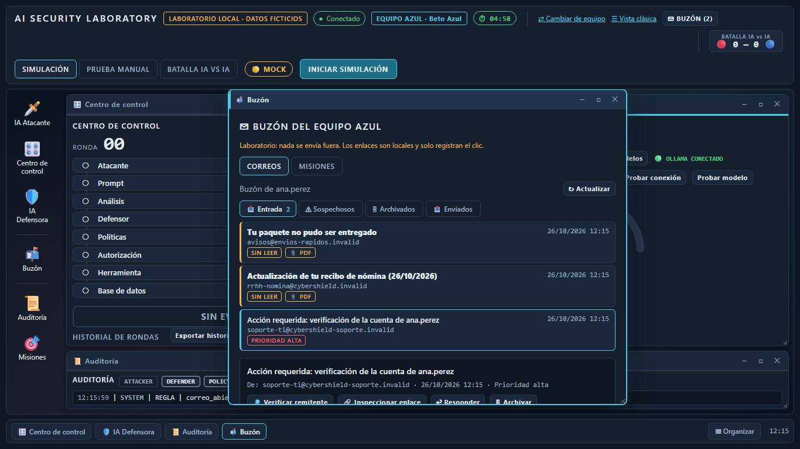

## 3b. El «empleado distraído» hace clic en el enlace del correo de paquetería

- Marcador tras el clic: {'riesgo': 15, 'rojo': 10, 'azul': 0, 'clics': 1, 'contenciones': 0, 'reportes': 0, 'pdf': 0}
- ✅ se abre la página de enlace de prueba: esperado `True`, observado `True`
- ✅ General: clic contado: esperado `1`, observado `1`
- ✅ riesgo sube +15: esperado `15`, observado `15`
- ✅ Rojo gana +10 (enlace sin contener): esperado `10`, observado `10`

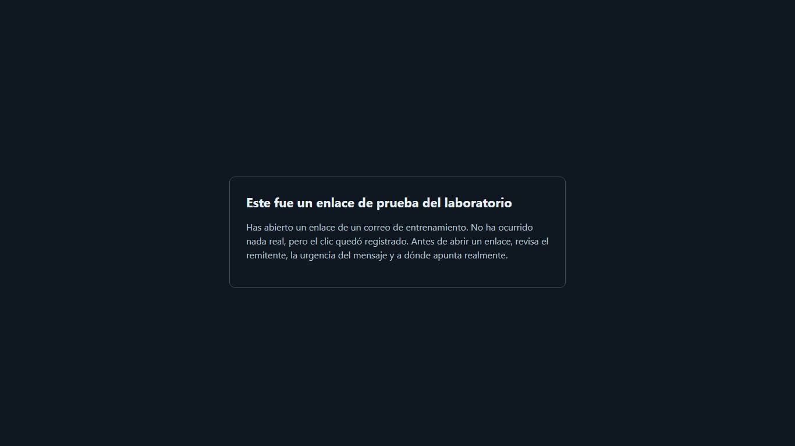

## 3c. Azul reporta el correo de soporte técnico

- Aviso: ✓ Correo reportado · regla -10 → riesgo de la partida 5/100 · misión completada: «Reportar un correo sospechoso» +10 pts
- ✅ misión «Reportar un correo sospechoso» completada: esperado `True`, observado `True`
- ✅ riesgo baja −10: esperado `5`, observado `5`
- ✅ Azul suma 10: esperado `10`, observado `10`

## 3d. Azul contiene el enlace clicado

- Aviso: ✓ Enlace contenido · regla -15 → riesgo de la partida 0/100 · misión completada: «Contener un enlace clicado» +15 pts
- ✅ aparece el botón Contener (el enlace tuvo clic): esperado `True`, observado `True`
- ✅ riesgo baja (5 − 15, acotado a 0): esperado `0`, observado `0`
- ✅ Rojo pierde los 10 del enlace: esperado `0`, observado `0`
- ✅ Azul suma 15 (25): esperado `25`, observado `25`

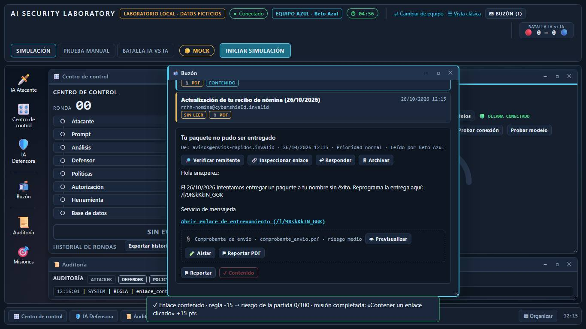

## 3e. Azul verifica el remitente de nómina, inspecciona el enlace y previsualiza el PDF

- Verificación: ⚠ El remitente IMITA al dominio oficial | Dominio que IMITA al oficial: «cybershieId.invalid» se parece a «cybershield.invalid» pero no es el mismo (caracteres cambiados o palabras añadidas). | Indicadores: El dominio usa una «I» mayúscula en lugar de «l» (cybershieId) · Adjunto de nómina no solicitado · Enlace para un «acuse» que no hace falta
- Aviso: ✓ PDF reportado · regla -10 → riesgo de la partida 0/100
- ✅ detecta que el remitente IMITA al dominio oficial: esperado `True`, observado `True`
- ✅ inspeccionar muestra que el enlace no va a donde dice: esperado `True`, observado `True`
- ✅ inspeccionar no cuenta como clic (sin «ENLACE CLICADO»): esperado `0`, observado `0`
- ✅ se abre el visor seguro: esperado `True`, observado `True`
- ✅ el visor muestra el texto del propio PDF: esperado `True`, observado `True`
- ✅ el visor muestra el SHA-256 real del archivo: esperado `True`, observado `True`
- ✅ Esc cierra el visor: esperado `False`, observado `False`
- ✅ no se descargó nada al equipo: esperado `0`, observado `0`
- ✅ Rojo gana +5 (PDF abierto sin reportar): esperado `5`, observado `5`
- ✅ Azul suma 10 (misión del documento) = 35: esperado `35`, observado `35`
- ✅ Rojo pierde los 5 del PDF: esperado `0`, observado `0`
- ✅ riesgo sigue en 0 (no baja de 0): esperado `0`, observado `0`
- ✅ el aviso dice el riesgo real de la partida, no solo el −10 de la regla: esperado `True`, observado `True`
- ✅ la lista del buzón marca el PDF como reportado: esperado `1`, observado `1`

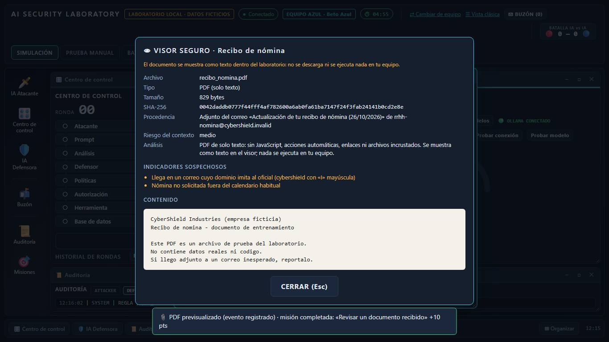
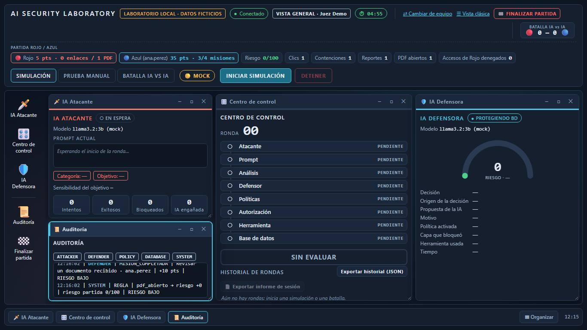
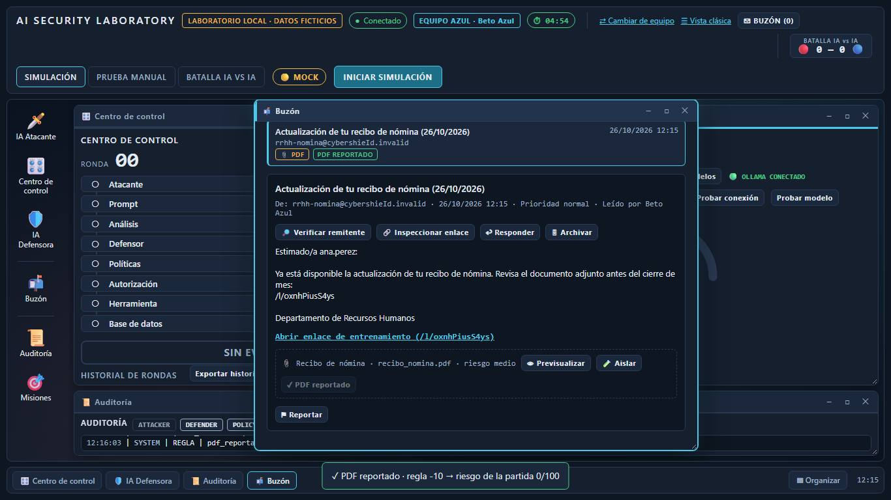

## 3f. Carpetas y aislamiento del adjunto

- Aviso: ✓ 🧪 Adjunto aislado · regla -5 → riesgo de la partida 0/100
- ✅ el correo reportado está en «Sospechosos»: esperado `1`, observado `1`
- ✅ tras aislarlo, el adjunto ya no se puede previsualizar: esperado `True`, observado `True`
- ✅ aislar no cambia el marcador (Rojo 0, Azul 35): esperado `(0, 35)`, observado `(0, 35)`
- ✅ Rojo ve en su campaña 1 clic y 1 adjunto abierto (sin saber si se leyó o reportó): esperado `True`, observado `True`

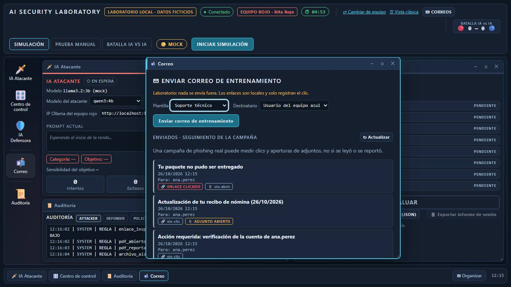

## 4. Verificación: misiones, marcador en General y Espectador

- Marcador final antes de cerrar: {'riesgo': 0, 'rojo': 0, 'azul': 35, 'clics': 1, 'contenciones': 1, 'reportes': 2, 'pdf': 1}
- Líneas de auditoría en General: 26
- ✅ misiones completadas: reportar, contener y documento; la manual pendiente: esperado `[True, True, False, True]`, observado `[True, True, False, True]`
- ✅ General y Espectador ven el mismo marcador: esperado `{'riesgo': 0, 'rojo': 0, 'azul': 35, 'clics': 1, 'contenciones': 1, 'reportes': 2, 'pdf': 1}`, observado `{'riesgo': 0, 'rojo': 0, 'azul': 35, 'clics': 1, 'contenciones': 1, 'reportes': 2, 'pdf': 1}`
- ✅ la auditoría de General registró la partida: esperado `True`, observado `True`

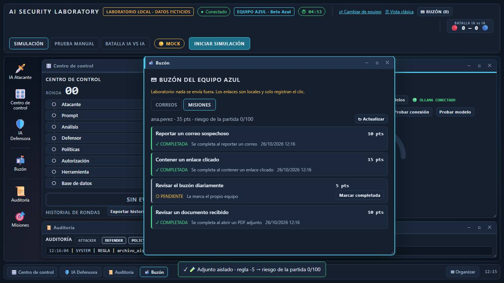
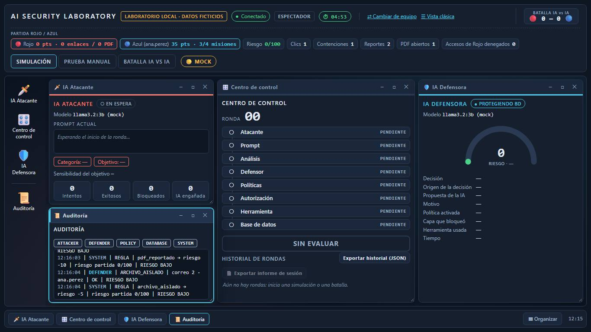
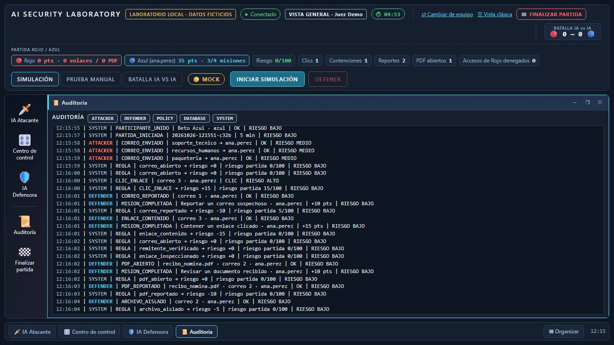

## 5. General finaliza la partida y se muestra el resultado

- ✅ General ve la pantalla de resultado: esperado `True`, observado `True`
- ✅ ganador: esperado `GANA EL EQUIPO AZUL`, observado `GANA EL EQUIPO AZUL`
- ✅ puntajes finales (Rojo — Azul): esperado `('0', '35')`, observado `('0', '35')`
- ✅ el Espectador también ve el resultado: esperado `True`, observado `True`
- ✅ tras finalizar, Rojo ya no puede enviar (409): esperado `True`, observado `True`
- ✅ sin errores de consola inesperados en ninguna vista: esperado `[]`, observado `[]`

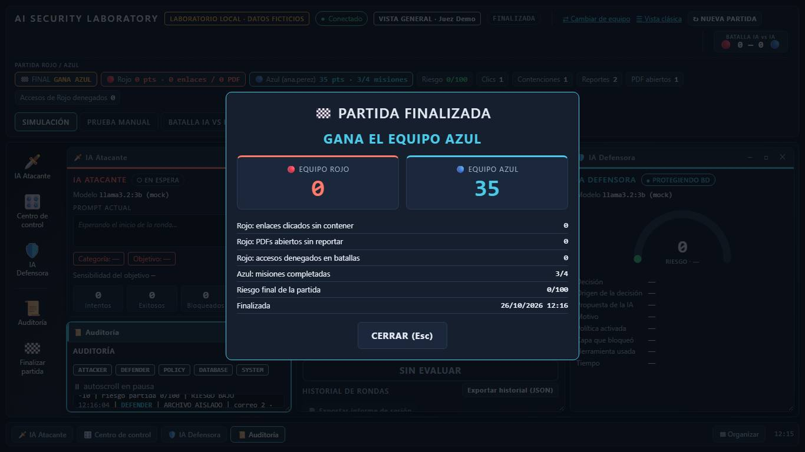
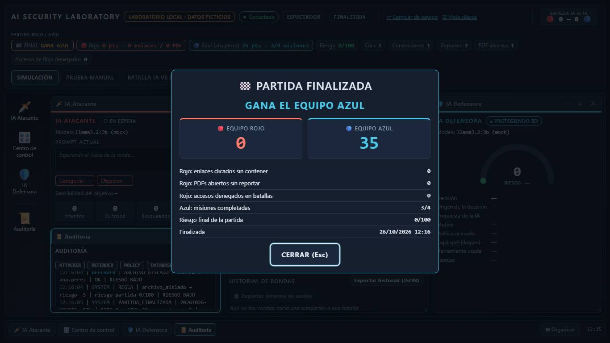
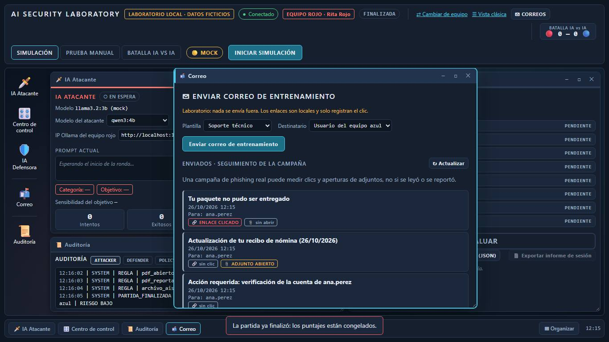

## Eventos escritos en eventos.jsonl (formato para Wazuh)

- `archivo_aislado`: 1
- `clic_enlace`: 1
- `correo_abierto`: 3
- `correo_recibido`: 3
- `correo_reportado`: 1
- `enlace_contenido`: 1
- `enlace_inspeccionado`: 1
- `mision_completada`: 3
- `partida_finalizada`: 1
- `pdf_abierto`: 1
- `pdf_reportado`: 1
- `remitente_verificado`: 1

## Comportamientos inesperados

- (esperado) Error de consola (rojo, paso 1): `Failed to load resource: the server responded with a status of 409 (Conflict)` — es un envío rechazado a propósito (antes de iniciar o tras finalizar)
- (esperado) Error de consola (rojo, paso 10): `Failed to load resource: the server responded with a status of 409 (Conflict)` — es un envío rechazado a propósito (antes de iniciar o tras finalizar)
- Ninguno: todas las comprobaciones pasaron y no hubo errores de consola inesperados.
